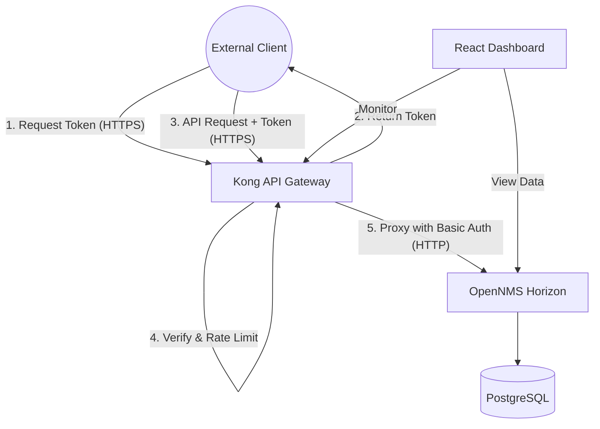

# 🛡️ Project 18: Secure API Gateway for NMS Northbound Interfaces

Welcome to the **Secure API Gateway for NMS Northbound Interfaces** repository! This project implements a secure, scalable, and high-performance API Gateway using Kong to protect the OpenNMS Northbound REST APIs. It provides industry-standard security features including OAuth2 authentication, rate limiting, and HTTPS encryption.


> 📖 **Quick Links:**
> - 🚀 **[Complete Laptop Setup & Deployment Guide](docs/SETUP_GUIDE.md)** — Step-by-step instructions to clone, run, and test on any machine.
> - 🖥️ **[Web Dashboard UI Guide](docs/UI_GUIDE.md)** — Full guide explaining all screens, buttons, metrics, and security tests.

---

## 🏗️ Architecture Overview

The system uses Kong as an API Gateway in front of OpenNMS. External clients never talk directly to OpenNMS. Instead, they authenticate with Kong via OAuth2 and make secured requests over HTTPS, which are then rate-limited and proxied to OpenNMS.



### Request Flow
1. **Authentication**: External Client requests an OAuth2 token from Kong.
2. **Authorization**: Kong verifies credentials and issues a JWT token.
3. **API Call**: Client makes a request to a protected endpoint with the bearer token.
4. **Validation & Rate Limiting**: Kong verifies the token and applies rate limiting policies.
5. **Proxy**: If valid, Kong translates the auth to Basic Auth and proxies the request to OpenNMS.

---

## 💻 Technologies Used

| Technology | Version | Purpose |
|------------|---------|---------|
| **OpenNMS Horizon** | 36.0.4 | Network Management System backend |
| **Kong Gateway** | 3.9 | API Gateway for securing endpoints |
| **PostgreSQL** | 15 | Database for OpenNMS |
| **Docker & Docker Compose**| latest | Containerization and orchestration |
| **React + Vite** | 18 | Real-time monitoring dashboard |
| **OAuth2** | 2.0 | Standardized API authentication |
| **HTTPS/TLS** | 1.2+ | Secure communication |
| **Nginx** | latest | Dashboard Web Server |

---

## 📁 Project Structure

```text
project_name/
├── certs/                  # TLS certificates and generation scripts
├── dashboard/              # React + Vite dashboard source code
├── scripts/                # Bash scripts for setup, testing, and utilities
│   ├── setup-kong.sh       # Script to configure Kong routes and plugins
│   └── test-api.sh         # E2E test script for endpoints
├── .env.example            # Example environment variables
├── docker-compose.yml      # Container orchestration
└── README.md               # Project documentation
```

---

## 🛠️ Prerequisites

Before you begin, ensure you have the following installed:
- **Docker & Docker Compose** (v2+)
- **OpenSSL** (for TLS certificate generation)
- **curl** (for API testing)
- **Git**

---

## 🚀 Quick Start Guide

Follow these steps to get the project up and running:

1. **Clone the repository**
   ```bash
   git clone <repository-url>
   cd project_name
   ```

2. **Configure Environment**
   ```bash
   cp .env.example .env
   # Edit .env with your specific configurations if necessary
   ```

3. **Generate TLS Certificates**
   ```bash
   # Use existing or generate new self-signed certs
   mkdir -p certs
   openssl req -x509 -newkey rsa:4096 -keyout certs/key.pem -out certs/cert.pem -sha256 -days 365 -nodes -subj '/CN=localhost'
   ```

4. **Start All Services**
   ```bash
   docker compose up -d
   ```

5. **Wait for Initialization**
   Wait approximately 60 seconds for OpenNMS and PostgreSQL to fully initialize.

6. **Run Kong Setup Script**
   Configure routes, services, OAuth2, and rate-limiting plugins:
   ```bash
   bash scripts/setup-kong.sh
   ```

7. **Access the Dashboard**
   Navigate to [http://localhost:3000](http://localhost:3000)

8. **Run Tests**
   Verify everything is working correctly:
   ```bash
   bash scripts/test-api.sh
   ```

---

## 🔌 Service Ports

| Service | Port | URL | Purpose |
|---------|------|-----|---------|
| **Kong Proxy (HTTP)** | 8000 | http://localhost:8000 | API Gateway (HTTP) |
| **Kong Proxy (HTTPS)** | 8443 | https://localhost:8443 | API Gateway (HTTPS) |
| **Kong Admin** | 8001 | http://localhost:8001 | Kong Administration |
| **OpenNMS Web UI** | 8980 | http://localhost:8980/opennms | NMS Web Interface |
| **Dashboard** | 3000 | http://localhost:3000 | Monitoring Dashboard |
| **OpenNMS DB** | 5432 | - | PostgreSQL for OpenNMS |

---

## 📖 API Usage Guide

The Northbound API is secured. You must first obtain a token, then use it for subsequent requests.

### 1. Get OAuth2 Token
```bash
curl -k -X POST https://localhost:8443/nms/oauth2/token \
  -d 'grant_type=client_credentials' \
  -d 'client_id=nms-client-id' \
  -d 'client_secret=nms-client-secret' \
  -d 'scope=nms-read'
```

### 2. Call API with Token
Replace `YOUR_TOKEN_HERE` with the token received from the previous step.
```bash
curl -k https://localhost:8443/nms/rest/info \
  -H 'Authorization: Bearer YOUR_TOKEN_HERE'
```

### 3. Available Endpoints
- `GET /nms/rest/info` - System information
- `GET /nms/rest/nodes` - Network nodes
- `GET /nms/rest/events` - Events
- `GET /nms/rest/alarms` - Alarms
- `GET /nms/rest/outages` - Outages

---

## 🔒 Security Features

- **OAuth2 Client Credentials Flow**: Ensures that only authenticated machine-to-machine clients can access the APIs.
- **Rate Limiting**: Protects the backend from DDoS and overuse by limiting traffic (100 req/min, 1000 req/hour).
- **HTTPS/TLS Encryption**: All external traffic is encrypted, protecting data in transit.
- **Upstream Auth Translation**: Kong handles OAuth2 externally but securely passes Basic Auth to the OpenNMS backend, completely decoupling external auth from the internal systems.

---

## ⏱️ Rate Limiting

Rate limiting is enforced at the Gateway level to ensure fair usage and backend stability. Responses include the following headers to help clients track their usage:

- `X-RateLimit-Limit-Minute`: 100 (Maximum requests per minute)
- `X-RateLimit-Remaining-Minute`: 99 (Remaining requests this minute)
- `X-RateLimit-Limit-Hour`: 1000 (Maximum requests per hour)
- `X-RateLimit-Remaining-Hour`: 999 (Remaining requests this hour)

---

## 🧪 Testing

To ensure the environment is correctly configured, run the automated test suite:
```bash
bash scripts/test-api.sh
```
This script verifies:
1. Retrieval of OAuth2 tokens.
2. Successful authenticated calls to the proxy.
3. Rejection of unauthenticated requests (401 Unauthorized).
4. Proper Rate Limiting enforcement.
5. Proper routing to OpenNMS backend.

---

## 📊 Dashboard Features

*Insert screenshot of Dashboard here*
``

The React-based dashboard provides a unified view of:
- API Gateway health and metrics
- Rate limit utilization
- OpenNMS backend status
- Quick access links to various services

---

## 🐛 Troubleshooting

- **Kong not starting**: Check if the database migration ran successfully in the Kong logs.
- **502 Bad Gateway**: OpenNMS is likely not ready yet. Wait a few more minutes for the JVM to fully start.
- **Certificate errors**: Ensure you are using `-k` with curl for self-signed certificates, or regenerate the certs.
- **OAuth2 401 Unauthorized**: The setup script might have failed or wasn't run. Re-run `bash scripts/setup-kong.sh`.

---

## ✅ Project Requirements Checklist

- [x] Set up Kong API Gateway in Docker
- [x] Run OpenNMS in Docker
- [x] Configure routing from Kong to OpenNMS
- [x] Secure API with HTTPS/TLS
- [x] Implement OAuth2 Authentication
- [x] Apply Rate Limiting
- [x] Create React Dashboard
- [x] Provide testing scripts

---

## 📄 License

This project is licensed under the [MIT License](LICENSE).
